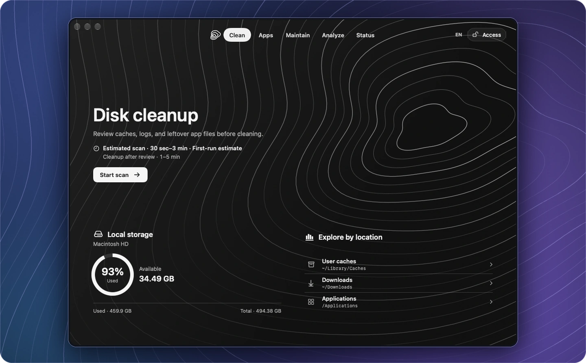
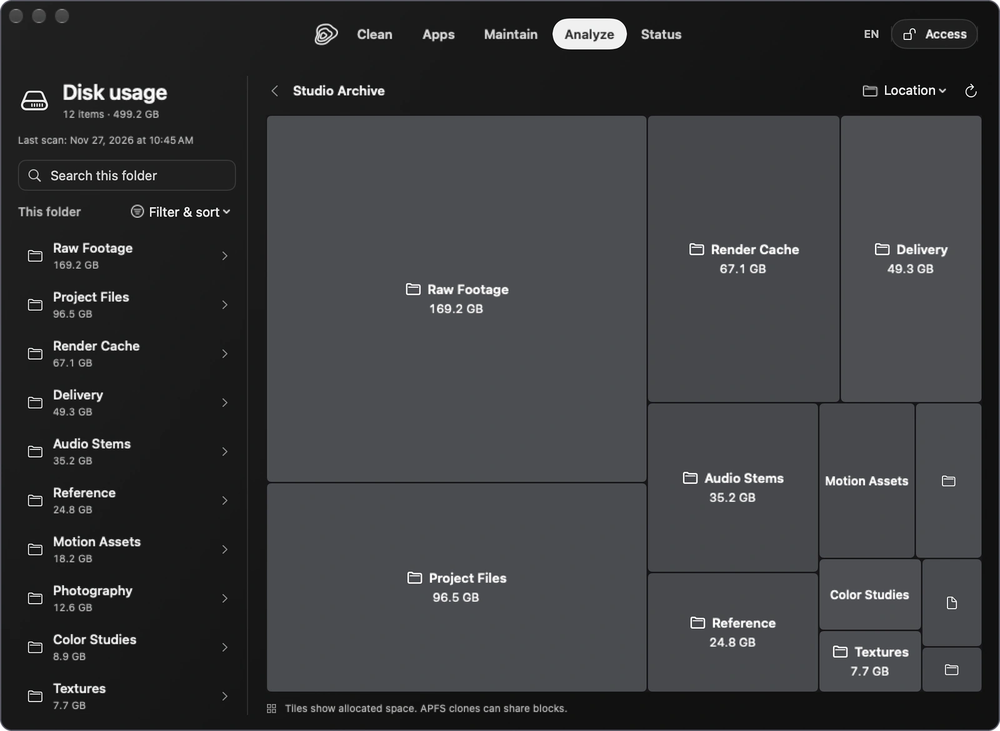
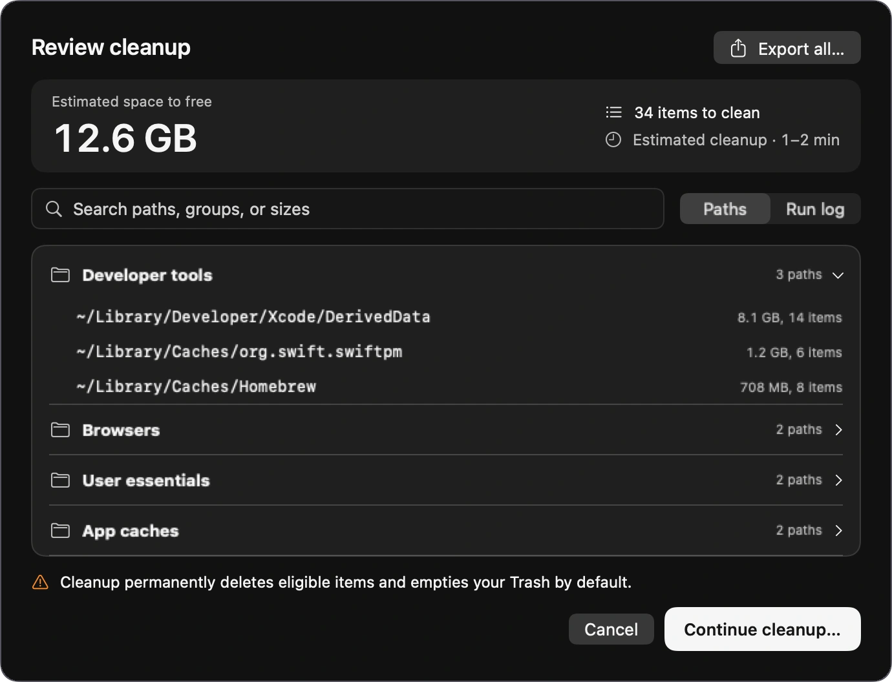
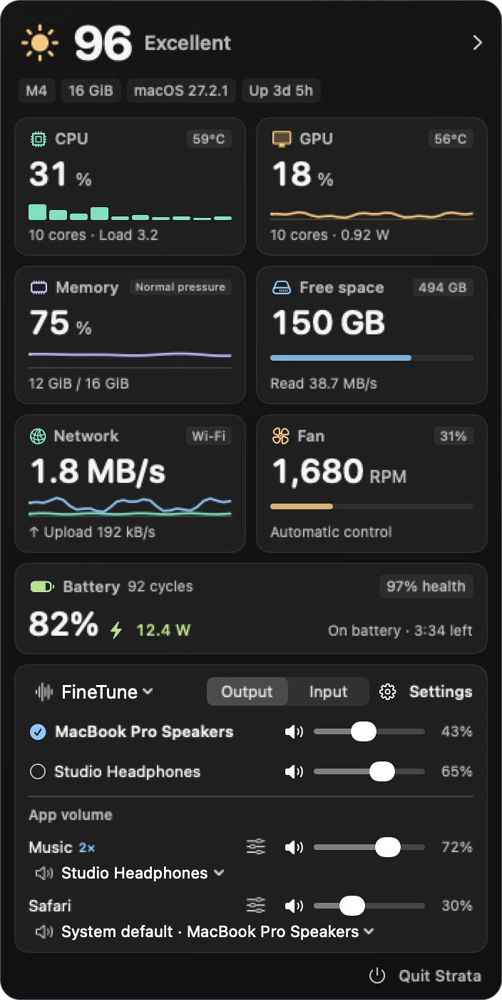

<p align="center">
  
</p>

<h1 align="center">Strata</h1>

<p align="center"><strong>See where your disk space goes.</strong></p>

<p align="center">
  A native macOS app for disk analysis, cleanup previews, live system stats, and per-app audio.
</p>

<p align="center">
  <strong><a href="https://github.com/AhYesYesYes111/Strata/releases/download/v0.7.0/Strata.zip">Download for macOS</a></strong>
  · <a href="#install-on-macos">Install</a>
  · <a href="#build-from-source">Build from source</a>
  · <a href="README_CN.md">简体中文</a>
</p>

<p align="center"><sub>Apple silicon · macOS 13+ · Audio controls on macOS 15.4+</sub></p>

<p align="center">
  <a href="docs/img/strata-clean-en.png">
    
  </a>
</p>

## Explore Strata

### Follow the space

Open your startup disk or a folder in **Analyze**. The bigger the tile, the more space it takes. Click a folder to see what’s inside, or reopen your last completed scan and rescan when you need fresh numbers.

<p align="center">
  
</p>

### Review before you clear

**Clean** scans for caches, logs, and app leftovers and estimates how much space you can reclaim. Expand categories to inspect paths, search the report, or export it as text. When you confirm, Strata checks the full cleanup plan again and asks you to review any changes.

> Search filters the report display. Confirming cleanup permanently deletes eligible items and empties your personal Trash by default.

<p align="center">
  
</p>

### Check your Mac and mix your audio

**Status** shows CPU, GPU, memory pressure, disk activity, network, and battery. Use the main window to search and sort processes, or click the Strata menu bar icon for a quick look.

The same menu puts **FineTune** within reach. Turn down a single app, route its sound to one or more outputs, or adjust its gain and EQ.

<p align="center">
  
</p>

**Apps** lists installed app versions and bundle sizes, and can reveal apps in Finder. **Maintain** previews maintenance tasks and shows why tasks are skipped. [Desktop guide (简体中文)](native/MoleDesktop/README.md)

## Install on macOS

Download `Strata.zip`, extract it, and move `Strata.app` to **Applications**. The published build runs on Apple silicon with macOS 13 or later. FineTune audio controls require macOS 15.4 or later. [Release notes and SHA-256 checksum](https://github.com/AhYesYesYes111/Strata/releases/tag/v0.7.0)

<details>
<summary>If macOS blocks the first launch</summary>

The release is ad-hoc signed and ships without Apple notarization. Verify the archive against the checksum in the release notes, then follow Apple’s instructions to open it. [Apple’s first-launch guide](https://support.apple.com/en-us/102445)

</details>

The SwiftUI interface supports English and Simplified Chinese. To measure a protected folder, select it in **Analyze**. **Access** opens Full Disk Access settings when you need them. [Permissions and keyboard shortcuts](native/MoleDesktop/README.md#使用)

## Build from source

Use **Python 3** and a full **Xcode** installation with the **macOS 26 SDK or later**.

```sh
git clone https://github.com/AhYesYesYes111/Strata.git
cd Strata
python3 native/MoleDesktop/build.py
open native/MoleDesktop/build/Strata.app
```

The script builds for your Mac’s architecture and writes both `Strata.app` and `Strata.zip` to `native/MoleDesktop/build/`. The default build includes FineTune and resolves pinned Swift packages on the first run. Add `--without-finetune` for a disk-tools-only build.

If a synced checkout makes the build direct you to the ZIP, extract it to a local folder before opening it. You can also set a local output path with `--output-dir`. [Desktop source and tests](native/MoleDesktop)

## Credits and license

Strata’s desktop interface is built in SwiftUI. Cleanup and maintenance use **Mole CLI** by tw93 and contributors. Audio controls use **FineTune** by Ronit Singh and contributors. This repository includes FineTune and the macOS, Linux, and Windows editions of Mole CLI. [Component guide](components/README.md) · [Mole](https://github.com/tw93/Mole) · [FineTune](https://github.com/ronitsingh10/FineTune)

Strata and the bundled Mole scripts are released under **GPLv3**. [Full license](LICENSE) · [Component licenses and credits](LICENSES.md)
