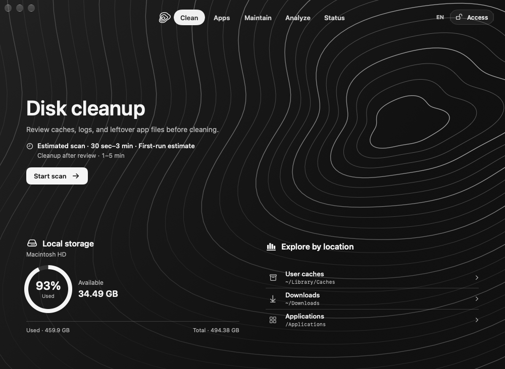

# Strata

Strata is a native macOS app that shows where your disk space goes, lets you review cleanup candidates, and tracks system activity in the window and menu bar. Its SwiftUI interface is available in English and Simplified Chinese.

[Build Strata](#build-strata) · [Using Strata](#using-strata) · [Mole CLI](#about-the-upstream-mole-cli) · [简体中文](README_CN.md)



## Build Strata

Strata runs on **macOS 13 or later**. Building from source requires **Python 3** and **a full Xcode installation with the macOS 26 SDK or newer**.

```sh
git clone https://github.com/AhYesYesYes111/Strata.git
cd Strata
python3 native/MoleDesktop/build.py
open native/MoleDesktop/build/Strata.app
```

The default build compiles FineTune from this repository, embeds it in the locally signed app, and writes `native/MoleDesktop/build/Strata.zip`. Audio controls require macOS 15.4 or later. Xcode resolves the pinned Swift packages on the first build. Pass `--without-finetune` for a disk-tools-only build.

## Using Strata

| View | What you can do |
| --- | --- |
| **Analyze** | Open the startup disk or a folder of your choice. Select a tile to see what takes up space inside it, or rescan to refresh the saved result. |
| **Clean** | Run a preview to estimate reclaimable space from caches, logs, and app leftovers. Search the report or export it as text. |
| **Status** | Check CPU, memory, disk activity, network, and battery. Search and sort processes, or open the menu bar panel for a quick overview. |
| **Apps** | Search installed applications, check their versions, and reveal them in Finder. |
| **Maintain** | Preview system maintenance tasks and see which ones Mole would skip. |

> **Review the report before confirming cleanup.** Search only filters the report. When you confirm, Mole scans again and runs a full cleanup using the current protection rules. It permanently removes eligible items and empties your personal Trash by default.

If you need to measure folders protected by macOS, **Access** opens Full Disk Access settings. The desktop guide covers permissions, keyboard shortcuts, report export, and tests. [Strata guide (简体中文)](native/MoleDesktop/README.md) · [Desktop source](native/MoleDesktop/Sources)

## About the upstream Mole CLI

The repository includes the complete FineTune Xcode project and the macOS, Linux, and Windows editions of Mole with their tests and packaging scripts. Run `./mo --help` on macOS or Linux. The Windows entry point is `components/Mole/windows/mole.ps1`. Build instructions for each platform are in the [component guide](components/README.md).

The desktop app bundles cleanup and maintenance scripts from Mole CLI, the terminal tool by tw93 and contributors. The upstream project also publishes its own desktop app, Mole Mac. [Mole CLI source](https://github.com/tw93/Mole) · [Mole Mac](https://mole.fit/)

## License

Strata and the bundled Mole CLI use the GNU General Public License, version 3. [Full license](LICENSE) · [Component credits and trademark policy](LICENSES.md)
