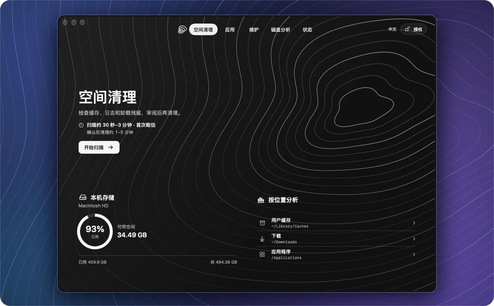
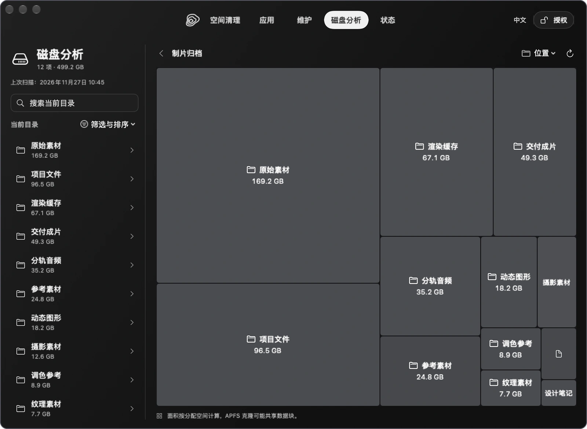
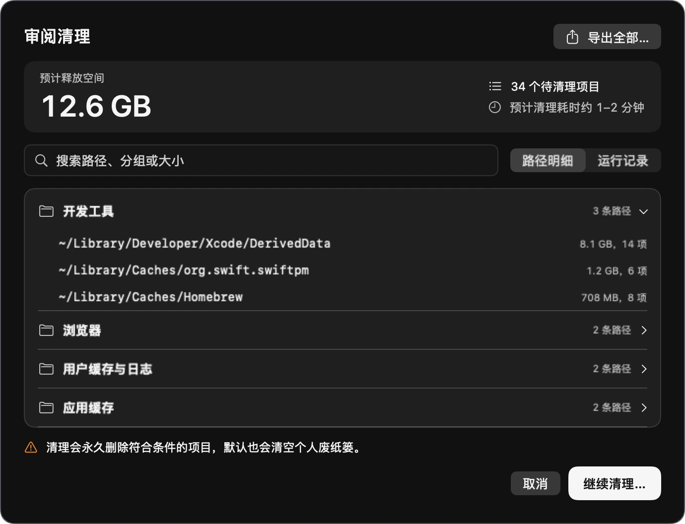
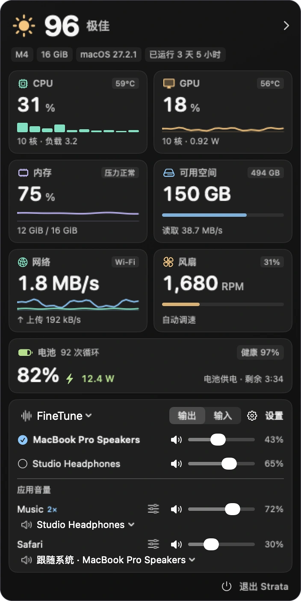

<p align="center">
  
</p>

<h1 align="center">Strata</h1>

<p align="center"><strong>看清 Mac 的空间去向。</strong></p>

<p align="center">
  一款原生 macOS 工具，集磁盘分析、清理预览、实时状态和分应用音量控制于一身。
</p>

<p align="center">
  <strong><a href="https://github.com/AhYesYesYes111/Strata/releases/download/v0.7.0/Strata.zip">下载 macOS 版</a></strong>
  · <a href="#下载与安装">安装</a>
  · <a href="#从源码构建">从源码构建</a>
  · <a href="README.md">English</a>
</p>

<p align="center"><sub>Apple 芯片 · macOS 13+ · 音频控制需 macOS 15.4+</sub></p>

<p align="center">
  <a href="docs/img/strata-clean-zh.png">
    
  </a>
</p>

## 探索 Strata

### 用面积看磁盘占用

在**磁盘分析**中打开启动盘或指定文件夹。方块越大，占用的空间越多。点击方块即可逐层查看子文件夹。Strata 会保存上次完成的扫描结果，需要更新时可以重新扫描。

<p align="center">
  
</p>

### 先看清单，再决定是否清理

**空间清理**会扫描缓存、日志和应用残留，估算可释放的空间。展开类别可查看具体路径，报告也支持搜索和导出。确认时，Strata 会重新核对整份清理清单，如有变化会请你重新审阅。

> 搜索只筛选报告的显示内容。确认清理后，符合条件的项目会被永久删除，个人废纸篓默认也会清空。

<p align="center">
  
</p>

### 看状态、调声音，都在菜单栏

在**状态**页查看 CPU、GPU、内存压力、磁盘读写、网络和电池。需要排查时，可在主窗口搜索和排序进程。平时点一下菜单栏的 Strata 图标，就能查看概况。

同一个菜单里还有 **FineTune**。可以单独调低某个应用的音量，把声音送到一个或多个输出设备，也能调整增益和均衡器。

<p align="center">
  
</p>

在**应用**页可查看已安装应用的版本、应用包大小，并在访达中定位。**维护**页可预览系统维护任务，查看跳过原因。[桌面使用指南](native/MoleDesktop/README.md)

## 下载与安装

下载并解压 `Strata.zip`，将 `Strata.app` 移到「应用程序」后打开。预编译版适用于搭载 **Apple 芯片**且运行 **macOS 13 或更新版本**的 Mac。FineTune 音频控制需要 macOS 15.4 或更新版本。[发布说明与 SHA-256 校验值](https://github.com/AhYesYesYes111/Strata/releases/tag/v0.7.0)

<details>
<summary>如果 macOS 阻止首次打开</summary>

发布包采用临时签名，未经 Apple 公证。可先按发布说明核对压缩包的校验值，再按 Apple 的步骤打开。[Apple 的首次打开指引](https://support.apple.com/zh-cn/102445)

</details>

SwiftUI 界面支持简体中文和英语。要测量受系统保护的文件夹，可先在**磁盘分析**中主动选择该位置。需要时，点**授权**即可打开「完全磁盘访问权限」设置。[权限与键盘快捷键](native/MoleDesktop/README.md#使用)

## 从源码构建

需要 **Python 3** 和包含 **macOS 26 或更新版 SDK** 的完整 **Xcode**。

```sh
git clone https://github.com/AhYesYesYes111/Strata.git
cd Strata
python3 native/MoleDesktop/build.py
open native/MoleDesktop/build/Strata.app
```

脚本会为当前 Mac 的架构构建，并将 `Strata.app` 和 `Strata.zip` 输出到 `native/MoleDesktop/build/`。默认构建内置 FineTune，首次运行时会获取锁定版本的 Swift 依赖。只构建磁盘工具可加 `--without-finetune`。

如果仓库位于同步目录，构建脚本可能会提示使用 ZIP。请解压到本机的非同步目录后打开，也可用 `--output-dir` 直接指定本地输出目录。[桌面源码与测试](native/MoleDesktop)

## 致谢与开源协议

Strata 的桌面界面使用 SwiftUI。清理与维护由 tw93 和贡献者开发的 **Mole CLI** 提供，音频控制由 Ronit Singh 和贡献者开发的 **FineTune** 提供。本仓库收录 FineTune 以及 Mole CLI 的 macOS、Linux 和 Windows 版本。[组件指南](components/README.md) · [Mole](https://github.com/tw93/Mole) · [FineTune](https://github.com/ronitsingh10/FineTune)

Strata 与随附的 Mole 脚本采用 **GPLv3**。[许可证全文](LICENSE) · [组件许可证与项目归属](LICENSES.md)
